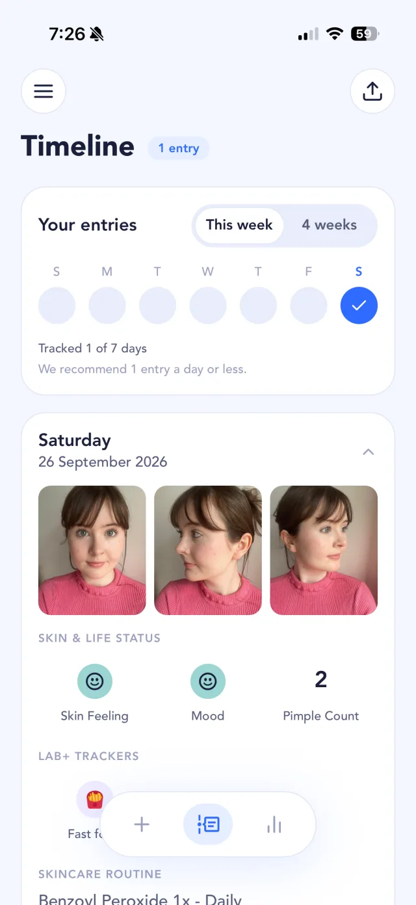
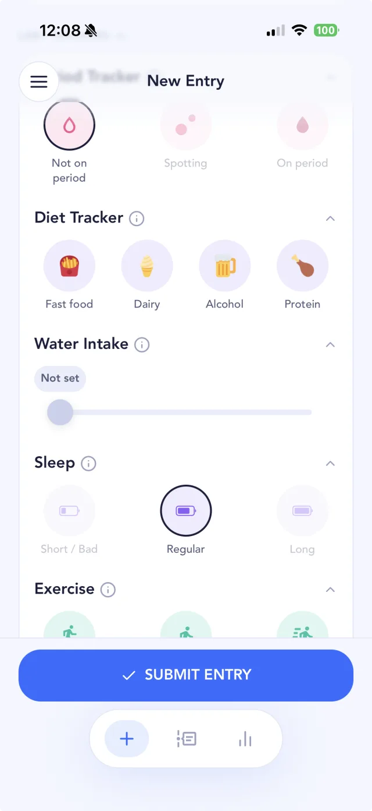
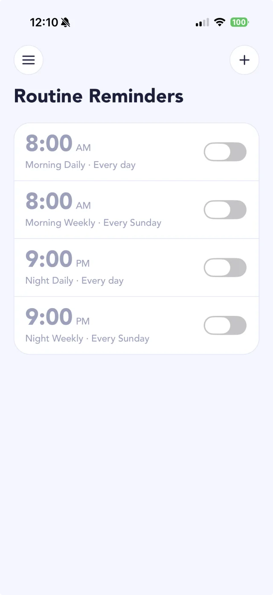
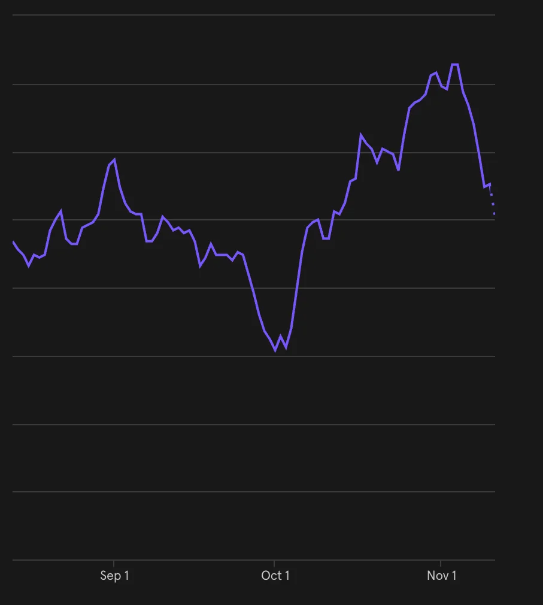

*Copy of an email update from our mailing list.*

Hi folks,

I'm not great with the whole marketing thing, so sorry about the lack of emails! I'm much more of a "hacking silently in a cave" type.

Anyway, I'm really excited to share some new stuff I've recently added to SkinTheory, in case you haven't checked out the app recently! Here are some of the things:

## Fancy schmancy new UI ✨

It took a little while, but I've done a large overhaul of the code and cleaned up the UI to bring it from 2020 into 2026. Definitely more updates to come here as well.

{: .screenshot width="640" height="1391"}

## 3 new (free!) trackers 🔬

I've added a few new, highly requested trackers (**Sleep**, **Water** and **Exercise**), and you can now use **any 2 of the Lab+ trackers for free** at a time.

{: .screenshot width="640" height="1391"}

## Advanced routine reminders ⏲️

Now you can add multiple routine reminders and customize when they repeat, to work around your tracking routine.

{: .screenshot width="640" height="1391"}

## Y'all seem to have noticed ❤️

I pushed out these updates around the start of October, and the number of people making entries in SkinTheory is way up! Hope you enjoy it, and let me know if you have any comments!

{: .narrow width="907" height="1010"}

## What's next?

I'm getting married in like 10 days, so I'm going to be a bit busy for the next month, but I've got some exciting updates planned for SkinTheory.

Our next plan is to make it **dead simple to see what's causing (or fixing) your acne and skin issues**.

Right now, this requires manual work to figure out what's going on with your skin. It's kind of hard, actually, so we want to surface insights about your skin and answer your questions with solid advice.

Join the email list below if you're interested in following the updates and my stream-of-consciousness thoughts!

Until next time,

Conor 
SkinTheory dev
