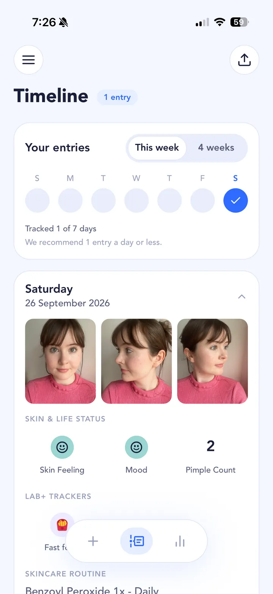

## The short answer

Psoriasis is a long-term condition where an overactive immune system makes your body produce new skin cells too fast, so they build up into dry, flaky, often itchy or sore patches. It's common: the AAD says [about 2% of people in the United States have it](https://www.aad.org/public/diseases/psoriasis/what/causes). It runs in families and isn't contagious. The NHS says [it often starts between 15 and 25, or between 50 and 60](https://www.nhs.uk/conditions/psoriasis/), and that it can't be cured, though treatment can manage it. Psoriasis isn't usually mistaken for acne: acne is pimples, blackheads and whiteheads, while psoriasis is mostly scaly patches. It can also affect your joints, which is why it's worth taking seriously.

## What it looks like, and how it's different from other rashes and acne

The NHS describes [dry, itchy, sore, flaky patches with what look like silvery-white scales](https://www.nhs.uk/conditions/psoriasis/), usually 1 to 2cm across, with a colour that depends on your skin tone. Common places are the scalp and behind the ears, elbows and forearms, knees and lower legs, the lower back, chest and tummy, and skin folds. Nails can get small dents and pits.

There are several types. The AAD says [plaque psoriasis is the most common, affecting about 80% to 90% of people with psoriasis](https://www.aad.org/public/diseases/psoriasis/what/symptoms). Others look different:

- **Guttate:** lots of small, scaly spots that appear suddenly, often on the body, arms and legs, often after an infection like strep throat.
- **Inverse:** smooth, red, raw-looking patches in skin folds, with little or no scale.
- **Pustular:** red, swollen, painful skin dotted with pus-filled bumps, usually on the hands and feet. The AAD notes these bumps aren't an infection.
- **Nail:** pits, discolouration, crumbling or nails lifting off the nail bed.

Pustular psoriasis is the type most likely to be confused with acne, because of the pus-filled bumps. But acne starts in hair follicles, mostly on the face, chest and back, and comes with blackheads and whiteheads. Psoriasis plaques are thick and scaly, and often sit on elbows, knees and the scalp.

Other rashes can look a lot like psoriasis. Only a doctor can diagnose it, so don't rely on photos online or on this page.

## What sets it off

Triggers can cause psoriasis to appear for the first time or make it flare. The [AAD](https://www.aad.org/public/diseases/psoriasis/what/causes), [NHS](https://www.nhs.uk/conditions/psoriasis/) and [National Psoriasis Foundation](https://www.psoriasis.org/causes/) list much the same ones:

- **Stress.** On every list. If stress is something you're curious about, our [stress guide](/acne-triggers/stress/) covers how to log it with mood.
- **Infections**, especially strep. The link between strep throat and guttate psoriasis is one of the clearer ones.
- **Skin injury**, such as cuts, scratches, sunburn, bug bites and even vaccinations.
- **Certain medicines.** Don't stop a prescribed medicine on your own; ask the prescriber.
- **Cold, dry weather.**
- **Smoking, and heavy drinking.** The AAD says heavy drinking; the NPF lists alcohol among the less common triggers. See our [alcohol guide](/acne-triggers/alcohol/).
- **Other factors** the NHS lists: living with obesity, pregnancy and sunlight.

Be honest with yourself about what these lists are. They're patient guides, not a ranking of research: the pages don't say how strong the evidence is for each trigger or how many people it affects. The NPF says plainly that [triggers vary from person to person](https://www.psoriasis.org/causes/). Psoriasis can also [go into remission and come back](https://www.niams.nih.gov/health-topics/psoriasis) on its own schedule, so a single bad week after a night out proves very little.

## How it's treated

SkinTheory doesn't recommend treatments and isn't a medical device. A doctor, dermatologist or pharmacist decides what's right for you. This is only an overview of what exists, so you know what to ask about:

- **Treatments you put on your skin**, such as moisturisers (emollients), steroid creams and vitamin D creams. The [NHS treatment overview](https://www.nhs.uk/conditions/psoriasis/) explains these.
- **Light therapy**, given under a dermatologist's supervision.
- **Medicines that work throughout the body**, including pills, injections and biologics, usually for more severe psoriasis or when psoriatic arthritis is involved. The [AAD's diagnosis and treatment page](https://www.aad.org/public/diseases/psoriasis/treatment/treatment) covers these.

## When to see a doctor

The NHS says to [see a GP](https://www.nhs.uk/conditions/psoriasis/) if:

- you have symptoms of psoriasis
- your treatment isn't working or is causing side effects
- you have joint pain, stiffness or swelling that keeps coming back

That last one matters. The NPF says [roughly 1 in 3 people with psoriasis also have psoriatic arthritis](https://www.psoriasis.org/about-psoriatic-arthritis/), which causes pain, swelling or stiffness in joints, morning stiffness, and sometimes sausage-like swelling of fingers or toes. Early diagnosis and treatment may help prevent permanent joint damage, so don't wait it out. Read more in the [NHS guide to psoriatic arthritis](https://www.nhs.uk/conditions/psoriatic-arthritis/).

## How to track it in SkinTheory

To be upfront: SkinTheory was built for acne. Pimple count doesn't really fit psoriasis, and the graphs are built around pimple count. For psoriasis, your photo timeline and your entries are the main record. Here's what's useful:

- **Three photos per entry** (front, left and right), saved in a private timeline that never goes to your camera roll. Photograph the same patches the same way each time, in the same light. Scrolling back weeks shows you whether a patch is spreading, fading or coming back in the same place.
- **Skin feeling and mood** in every entry. Mood is the closest thing to a stress log; there's no separate stress tracker.
- **Your skincare routine log**, so you can see what you used on your skin each day, and whether a flare lined up with a change.
- **A hypothesis** tested over a set number of entries, for example "Does alcohol make my psoriasis flare?" over 21 entries. Keep everything else as steady as you can while you test.
- **Lab+ trackers** such as Alcohol (one of the triggers on the lists above). You can use any two Lab+ trackers free at a time, and all your own data is free forever.
- **Routine reminders**, so you keep logging on good days too. The good days are what make the bad ones stand out.

There's no tracker for weather, infections, joint pain or medicines, so don't expect the app to cover those. Bring your photo timeline to appointments: it shows a doctor how your skin has looked over weeks, not just on the day you're seen.

{: .screenshot width="720" height="1565"}

## Learn more

- [Psoriasis](https://www.nhs.uk/conditions/psoriasis/) (NHS)
- [Psoriasis: Signs and symptoms](https://www.aad.org/public/diseases/psoriasis/what/symptoms) (American Academy of Dermatology)
- [Psoriasis](https://www.niams.nih.gov/health-topics/psoriasis) (NIAMS, US National Institutes of Health)
- [Psoriasis: Causes & Triggers](https://www.psoriasis.org/causes/) (National Psoriasis Foundation)
- [Psoriatic arthritis](https://www.nhs.uk/conditions/psoriatic-arthritis/) (NHS)
