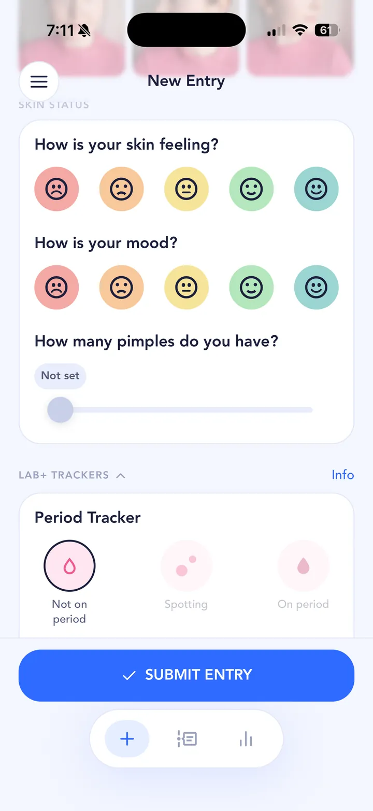

## The short answer

Adapalene (best known as Differin) is a topical retinoid, a gel or cream you put on your skin. Like other retinoids it works by clearing pores, and it can treat blackheads, whiteheads and some pimples.

In the US, an adapalene gel is sold over the counter, while other forms need a prescription. In the UK it's prescription-only.

It's slow. MedlinePlus says it may take 8 to 12 weeks or longer to feel the full benefit, and acne can get worse in the first few weeks.

## A typical timeline

Everyone's skin is different, and your pharmacist or dermatologist can tell you what to expect. For many people:

- **Weeks 1 to 4:** acne may get worse, and new pimples can show up. Redness, scaling, dryness and burning or stinging are most likely in the first 2 to 4 weeks.
- **Weeks 4 to 8:** irritation often settles, and you may start to see fewer breakouts. The American Academy of Dermatology says acne treatments generally take at least 6 to 8 weeks before breakouts reduce.
- **Weeks 8 to 12 and beyond:** the full benefit, if it's going to work for you.

Sun matters too: MedlinePlus advises limiting sun and tanning beds and wearing sunscreen while you use it.

## What’s worth tracking

- **Progress photos** at the same time and in the same light every day, starting before your first use.
- **Pimple count and how your skin feels.** Weeks one to four can feel like a step backwards. A log shows whether it's turning.
- **Side effects you notice,** like dryness, redness and stinging.
- **When you started,** and any change, like moving from the over-the-counter gel to a prescription.
- **Your routine around it:** moisturiser, sunscreen and anything you've added or dropped.

A few things make daily photos comparable: the same spot and the same light (a window in the morning, or the same lamp at night), hair back, no makeup, and roughly the same distance from the camera. Take your first entry before you start using it, so day one really is day one. Skipping a day isn't a disaster; the timeline still shows the trend.

## How to track it in SkinTheory

1. **Set a hypothesis**, like "Adapalene clears my breakouts in 12 weeks".
2. **Take three photos a day:** front, left and right in every entry.
3. **Log skin feeling, mood and pimple count** with the photos.
4. **Add adapalene to your skincare routine,** next to your moisturiser and sunscreen.
5. **Set routine reminders** for morning and night with custom repeats.
6. **Use the photo timeline as your before and after.**

{: .screenshot width="720" height="1565"}

## Was it the treatment, or something else?

Twelve weeks is a long time. Over that stretch you'll have stressful weeks, late nights, maybe a period or two and a few takeaways. Any of them can land on top of the early adapalene flare and make it hard to tell what's going on.

Log those alongside your treatment. SkinTheory's Lab+ trackers cover Exercise, Dairy, Fast food, Sleep, Alcohol, Water, Protein and Period. Your own data is free forever, and any two Lab+ trackers can be used free at a time. The graphs line your pimple count up against them over your last 21 entries, so you can see whether a flare lines up with the treatment or with your life.

Worth a read:

- [Dairy](/acne-triggers/dairy/) and [sugar](/acne-triggers/sugar/)
- [Your period](/acne-triggers/period/)
- [Alcohol](/acne-triggers/alcohol/), [sleep](/acne-triggers/sleep/) and [stress](/acne-triggers/stress/)
- [The gym](/acne-triggers/gym/) and [your bedsheets](/acne-triggers/bedsheets/)
- [New skincare products](/acne-triggers/skincare-products/)

## Keep the record

Your photos stay private in SkinTheory and never go to your camera roll. Keep the whole record on your phone for as long as you like, so if breakouts come back months later you can compare them with the first time.

If you see a dermatologist, bring your log. Twelve weeks of photos and pimple counts make the conversation about what to try next much easier.

## A note from Conor

Differin was one of the treatments I went through for severe adult acne in my early twenties, along with benzoyl peroxide, tretinoin and Accutane. My acne kept coming back and I didn't know why. What finally worked for me was getting scientific about it, and a gentler routine: moisturising more, keeping my skin clean without stripping the oils, and removing products rather than adding them.
