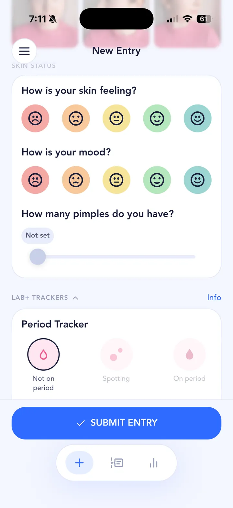

## The short answer

The combined pill (combined oral contraceptive) is hormonal contraception that can also help acne. The American Academy of Dermatology says it can be an effective acne treatment, and the NHS lists acne among the things it can help with, alongside heavy or painful periods.

It's prescribed after a check of your health and risk factors by a doctor, nurse or pharmacist. Which pill, and whether it suits you, is a conversation for them.

It works over cycles, not days. DermNet says acne usually improves by about 40 to 50% by the third cycle and 80 to 90% by the ninth.

## A typical timeline

Everyone is different, and your prescriber will tell you what to expect. As a rough picture:

- **First cycles:** not much visible change for many people. Some people report headaches, mood changes, feeling sick or dizzy, and sore breasts.
- **Around 3 months:** the NHS suggests speaking to a pharmacist or doctor if side effects are still a problem by now. DermNet puts acne improvement at around 40 to 50% by the third cycle.
- **Up to 9 cycles:** improvement can keep building, around 80 to 90% by the ninth cycle according to DermNet.
- **If you stop:** skin tends to get worse again within a few months.

Nine cycles is a long time to judge from memory. A photo record makes it obvious.

## What’s worth tracking

- **Progress photos** at the same time and in the same light every day.
- **Pimple count and how your skin feels.**
- **Your period,** so you can see how breakouts move with your cycle before and during the pill.
- **Mood and side effects you notice,** like headaches, to bring to your prescriber.
- **When you started,** and any change of pill.
- **Your skincare routine,** so you know whether anything else changed at the same time.

A few things make daily photos comparable: the same spot and the same light (a window in the morning, or the same lamp at night), hair back, no makeup, and roughly the same distance from the camera. Take your first entry before you start the pill, so day one really is day one. Skipping a day isn't a disaster; the timeline still shows the trend.

## How to track it in SkinTheory

1. **Set a hypothesis**, like "The pill reduces my breakouts by my sixth cycle".
2. **Take three photos a day:** front, left and right in each entry.
3. **Log skin feeling, mood and pimple count.**
4. **Turn on the Period tracker.** It's one of the Lab+ trackers, and any two can be used free at a time.
5. **Note the pill in your skincare routine** so every entry shows what you were on.
6. **Set routine reminders** with custom repeats for your skincare, and **use the photo timeline as your before and after.**

{: .screenshot width="720" height="1565"}

## Was it the treatment, or something else?

On the pill, the obvious question is whether a breakout is cycle-related or something else entirely: a stressful fortnight, a week of bad sleep, or a new face wash.

Log those alongside your cycle. SkinTheory's Lab+ trackers cover Period, Exercise, Dairy, Fast food, Sleep, Alcohol, Water and Protein. Your own data is free forever. The graphs line your pimple count up against them over the last 21 entries, so you can see whether a flare lines up with the treatment or with your life.

Worth reading:

- [Your period](/acne-triggers/period/)
- [Dairy](/acne-triggers/dairy/) and [sugar](/acne-triggers/sugar/)
- [Alcohol](/acne-triggers/alcohol/), [sleep](/acne-triggers/sleep/) and [stress](/acne-triggers/stress/)
- [The gym](/acne-triggers/gym/) and [your bedsheets](/acne-triggers/bedsheets/)
- [New skincare products](/acne-triggers/skincare-products/)

SkinTheory's experiments test one hypothesis over a set number of entries, such as 21. That's useful alongside a long treatment: once your skin has settled, you can test one life change at a time, like cutting dairy for 21 entries, and see whether the graphs move, without touching the treatment itself.

## Keep the record

Photos stay private in SkinTheory and never go to your camera roll. Keep the whole record on your phone for years. If you ever come off the pill and your skin changes, you'll have your before, during and after side by side.

Bring the log to your pill review. Cycle dates, photos and mood notes give your prescriber something real to work with.
