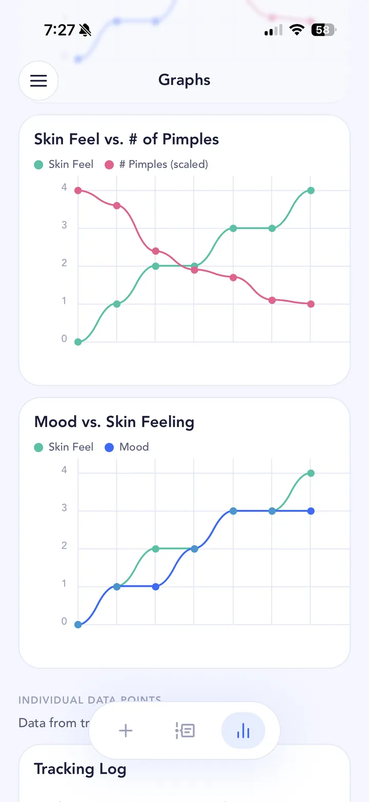

## The short answer

Spironolactone is a prescription tablet. For acne, it's used for women with stubborn hormonal acne, and the American Academy of Dermatology says it can treat acne on the face, chest and back. DermNet notes it tends to be most useful in women over 30. It isn't used for acne in men: the AAD notes side effects for men can include breast growth. In the UK it's prescribed off-label for acne, meaning acne isn't one of its licensed uses.

## What the evidence says

For a long time the evidence was thin: small trials, and a lot of clinical experience. That changed with the [SAFA trial](https://pmc.ncbi.nlm.nih.gov/articles/PMC10543374/) (BMJ, 2023), which randomised 410 women in England and Wales to spironolactone or a placebo. At 12 weeks the difference was small. By 24 weeks it was clearer: 82% on spironolactone said their acne had improved, against 63% on placebo. Headaches were more common on spironolactone (20% against 12%), and there were no serious side effects in the trial.

The American Academy of Dermatology's 2024 acne guideline gives spironolactone a conditional recommendation, a step below its strongest recommendations. So it's a well-supported option for some women, not a sure thing for everyone.

It's slow. One NHS hospital leaflet says most women notice improvement after about three months, with treatment continued for six months. DermNet says it may take six or more months.

## A typical timeline

Your doctor will tell you what to expect for you. As a rough picture:

- **Before you start:** a conversation with your doctor, and often a blood test to check your potassium level. Spironolactone shouldn't be taken if you're pregnant or trying to get pregnant, so contraception comes up too. If you're breastfeeding, tell your doctor.
- **First months:** little visible change for many people. Possible side effects include irregular periods, sore or swollen breasts, headaches, and dizziness or light-headedness. Rarer ones, like a high potassium level, are why your doctor may check your blood.
- **Around 3 months:** the point where many women start to notice improvement.
- **6 months and beyond:** closer to the full effect.

That's a long time to wait without data. It's also exactly the sort of change that's invisible day to day and obvious in a photo timeline.

## What’s worth tracking

- **Progress photos** at the same time and in the same light every day. Include your jawline and chin if that's where it shows up.
- **Pimple count and how your skin feels.**
- **Your cycle.** Hormonal acne often follows it, and irregular periods are a listed side effect.
- **Side effects you notice,** like sore breasts, headaches or dizziness, so you can tell your doctor when they started.
- **When you started,** and any changes your prescriber makes.
- **Your routine around it:** cleanser, moisturiser, sunscreen and any topical treatment.

A few things make daily photos comparable: the same spot and the same light (a window in the morning, or the same lamp at night), hair back, no makeup, and roughly the same distance from the camera. Take your first entry before you start the tablets, so day one really is day one. Skipping a day isn't a disaster; the timeline still shows the trend.

## How to track it in SkinTheory

1. **Set a hypothesis**, like "Spironolactone reduces my breakouts by month 6".
2. **Take three photos a day:** front, left and right in each entry.
3. **Log skin feeling, mood and pimple count.**
4. **Turn on the Period tracker** so your cycle sits next to every entry.
5. **Add spironolactone to your skincare routine** so each entry shows what you were on.
6. **Set routine reminders** with custom repeats, and **use the photo timeline as your before and after.**

{: .screenshot width="720" height="1565"}

## Was it the treatment, or something else?

Over six months, plenty else changes. A flare in month four might be the time of the month, a stressful week, or a new moisturiser, not a sign the treatment has stopped working.

Log the rest of your life alongside it. SkinTheory's Lab+ trackers cover Period, Exercise, Dairy, Fast food, Sleep, Alcohol, Water and Protein. Your own data is free forever, and any two Lab+ trackers can be used free at a time, so Period plus one other costs nothing. The graphs line your pimple count up against them over the last 21 entries, so you can see whether a flare lines up with the treatment or with your life.

Worth reading:

- [Your period](/acne-triggers/period/)
- [Dairy](/acne-triggers/dairy/) and [sugar](/acne-triggers/sugar/)
- [Alcohol](/acne-triggers/alcohol/), [sleep](/acne-triggers/sleep/) and [stress](/acne-triggers/stress/)
- [The gym](/acne-triggers/gym/) and [your bedsheets](/acne-triggers/bedsheets/)
- [New skincare products](/acne-triggers/skincare-products/)

SkinTheory's experiments test one hypothesis over a set number of entries, such as 21. That's useful alongside a long treatment: once your skin has settled, you can test one life change at a time, like cutting dairy for 21 entries, and see whether the graphs move, without touching the treatment itself.

## Keep the record

Photos stay private in SkinTheory and never go to your camera roll. Keep the whole record on your phone for years, so if acne returns later you can compare with the first time, cycle and all.

Bring your log to appointments. Six months of photos, pimple counts and period dates make the review conversation much more concrete.
