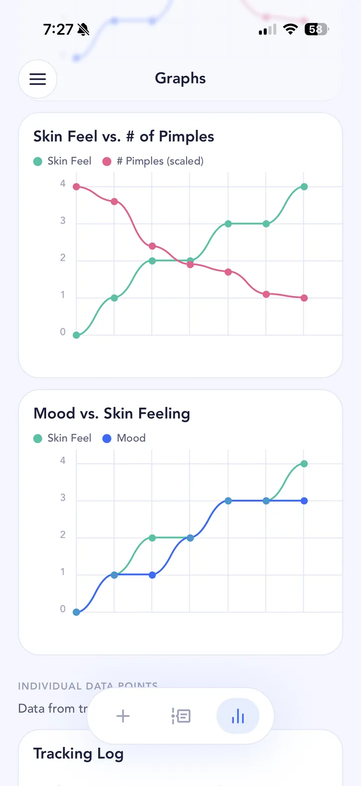

## The short answer

Tretinoin (one brand name is Retin-A) is a topical retinoid: a cream, gel or lotion you put on your skin. It works by clearing pores, and it can treat blackheads, whiteheads and some pimples. Dermatologists also use retinoids as a maintenance treatment once acne is under control.

It's a prescription medicine, and it isn't quick. Acne may get worse in the first week or so, and the American Academy of Dermatology says acne treatments generally take at least 6 to 8 weeks before you start to see fewer breakouts.

## A typical timeline

Your prescriber will tell you what to expect, but for many people it looks something like this:

- **Days 1 to 10: the purge.** Acne may seem to get worse during the first 7 to 10 days. MedlinePlus advises carrying on with the medication through this.
- **Weeks 2 to 6:** acne sores often start to improve after 2 to 3 weeks of regular use, sometimes taking more than 6 weeks.
- **Throughout:** dryness, peeling, redness, itching, burning or stinging where you apply it are common. Tell your doctor if they're severe or don't go away.
- **Weeks 6 to 8 and beyond:** fewer breakouts for many people, which is when most dermatologists would expect you to judge how it's going.

Sun matters too. MedlinePlus advises limiting sun and tanning beds and wearing sunscreen, especially over the treated areas.

## What’s worth tracking

- **Progress photos** at the same time and in the same light every day. The purge is far less scary when you can see it start and stop.
- **Pimple count and how your skin feels.** Peeling, tight and stinging in week one, calmer later.
- **Side effects you notice,** like dryness, redness or irritation, and when they eased.
- **When you started,** and any changes your prescriber makes.
- **Your routine around it:** moisturiser, sunscreen, cleanser, anything new.

## How to track it in SkinTheory

1. **Set a hypothesis**, like "Tretinoin reduces my breakouts within 8 weeks".
2. **Take three photos a day** (front, left and right) in each entry.
3. **Log skin feeling, mood and pimple count** alongside them.
4. **Add tretinoin to your skincare routine,** with your moisturiser and sunscreen, so every entry shows what you were using.
5. **Set routine reminders** for morning and night with custom repeats.
6. **Use the photo timeline as your before and after,** and the graphs to watch your pimple count over the last 21 entries.

{: .screenshot width="720" height="1565"}

## Was it the treatment, or something else?

This is the big question with tretinoin. Is a flare in week two the purge, or the pizza and three late nights? Is your skin still bad in week eight because the tretinoin isn't working, or because of your period?

While you're on the treatment, log the rest of your life too. SkinTheory's Lab+ trackers cover Exercise, Dairy, Fast food, Sleep, Alcohol, Water, Protein and Period. Your own data is free forever, and any two Lab+ trackers can be used free at a time. The graphs line your pimple count up against them, so you can see whether a flare lines up with the treatment or with your life.

Worth reading while you track:

- [Dairy](/acne-triggers/dairy/) and [sugar](/acne-triggers/sugar/)
- [Your period](/acne-triggers/period/)
- [Alcohol](/acne-triggers/alcohol/), [sleep](/acne-triggers/sleep/) and [stress](/acne-triggers/stress/)
- [The gym](/acne-triggers/gym/) and [your bedsheets](/acne-triggers/bedsheets/)
- [New skincare products](/acne-triggers/skincare-products/), easy to blame on the tretinoin when it's actually the new moisturiser

## Keep the record

Photos stay private in SkinTheory and never go to your camera roll. You can keep the whole history on your phone for years, so if your skin changes after you stop or switch treatment, you can compare it with the first time.

Take your log to your appointments. "It got worse for about ten days, then started settling in week three" is a lot more useful to a dermatologist than "I think it's working?".

## A note from Conor

Tretinoin was one of the treatments I worked through for severe adult acne in my early twenties, along with benzoyl peroxide, Differin and Accutane. The acne kept coming back and I didn't know why. Back then my photos were in Flickr and my notes were in one long Google Doc. What finally worked for me was getting scientific about it, plus a gentler routine: moisturising more, keeping my skin clean without stripping the oils, and removing products rather than adding them.
