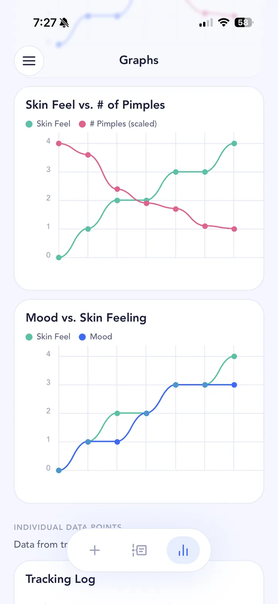

## The short answer

Nobody knows for sure. There's very little research looking directly at alcohol and acne: a few observational studies with small or indirect findings, and no trials. Many people do notice breakouts after drinking, but drinking usually comes with late nights, different food and sugary mixers, so it's hard to blame the alcohol alone. If you suspect it, tracking is the best way to find out.

## What the research says

Alcohol has a better-studied link with other skin conditions than with acne. A [2026 review of drinks and skin health](https://pubmed.ncbi.nlm.nih.gov/42805319/) found that alcohol has the most consistently reported harmful skin associations of any common drink, including triggering rosacea and links with psoriasis, hives and skin cancer, while noting the causal evidence isn't uniform. Acne isn't one of the conditions it highlights for alcohol.

Only a few acne studies have looked at drinking, and none can show cause and effect:

- A [2025 study of 218 people treated for acne in China](https://pubmed.ncbi.nlm.nih.gov/41221639/) found that nearly half saw their acne come back after treatment. Drinking was one of several factors linked to that, along with smoking, a higher BMI, staying up late, poor eating habits, low mood, anxiety and long screen time. It looked back at the records of one group of patients, so it can't show that alcohol caused anything.
- A [2025 survey of about 6,200 young Chinese adults in Singapore and Malaysia](https://pubmed.ncbi.nlm.nih.gov/40527305/) found that occasional drinking was linked to somewhat higher odds of blackheads and whiteheads. Having parents who had acne was by far the strongest factor. It was a one-off survey, so it can't separate alcohol from everything that comes with it.

The American Academy of Dermatology's [page on what causes acne](https://www.aad.org/public/diseases/acne/causes/acne-causes) says acne may worsen if you get too little sleep or eat certain foods, and that smoking may trigger acne. It doesn't mention alcohol, but several of those things tend to travel with a night of drinking.

## Why it varies from person to person

How much you drink, what you drink and what comes with it all differ. A glass of wine with dinner is a different experiment from six sugary cocktails, a 3am kebab and four hours of sleep. Drinking often comes with less [sleep](/acne-triggers/sleep/), more [stress](/acne-triggers/stress/) and different food, which have their own possible links to acne.

There are practical things too. Falling asleep without taking makeup off is easier after a few drinks, and the AAD lists [sleeping in makeup](https://www.aad.org/public/diseases/acne/skin-care/habits-stop) as a habit that can cause breakouts. If your skin is worse after a night out, the question isn't just "is it alcohol?" but "which part of the night was it?"

## How to test it on your own skin

This is where your own data beats generic advice. SkinTheory lets you get scientific about your skin and isolate whether it's the drink or everything around it.

1. **Hypothesis.** Make it specific, for example "Do I break out two days after drinking?" Set it up as a hypothesis in SkinTheory.
2. **Track.** Each entry, take your three skin photos and log skin feeling, mood and pimple count, plus the **Alcohol** tracker. If you can, add **Sleep** as your second tracker, since late nights are the most likely confounder. Keep your skincare routine the same, including on nights out.
3. **Analyze.** After about 21 entries (3 weeks if you log daily), compare your Alcohol log against your pimple count in the graphs. Look a day or two after drinking days, not just the same day, and check the photo timeline. Acne changes slowly (the AAD says even proven treatments take [at least 6 to 8 weeks](https://www.aad.org/public/diseases/acne/derm-treat/treat) to reduce breakouts), so a few weeks more makes the picture clearer.

{: .screenshot width="720" height="1565"}

Your entries and photos stay private in SkinTheory, never in your camera roll, and the history is yours to keep. Alcohol and Sleep are both Lab+ trackers, and any two Lab+ trackers can be used for free at a time, which covers this exact test.

## Tips while you test

- Do your evening routine before you go out, or at least take makeup off before bed.
- Log honestly. A test only works if the "drinking days" are real.
- Try to keep sleep similar on drinking and non-drinking nights for a cleaner comparison, or log it so you can tell them apart.
- If you're on acne medication, are pregnant, or are worried about how much you drink, talk to a doctor.

If your breakouts line up with takeaways and mixers, read about [sugar and fast food](/acne-triggers/sugar/); if they line up with short nights, see [sleep](/acne-triggers/sleep/). And if you're on a treatment, log alcohol alongside it so you know whether it's the [treatment](/acne-treatments/) or your weekends that are changing your skin.
