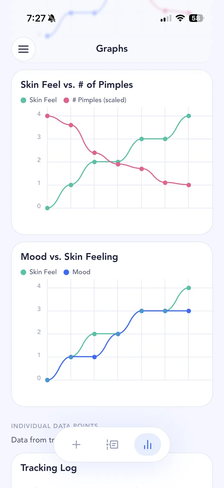

## The short answer

Dairy, and cow's milk in particular, is linked to acne in several large studies, and the link looks a little stronger for skim milk. But those studies show an association, not proof that dairy causes acne. For some people it seems to matter a lot; for many it doesn't seem to matter at all. The only way to know about your skin is to test it.

## What the research says

The American Academy of Dermatology (AAD) says [some studies suggest drinking cow's milk, including skim, may be linked to more breakouts](https://www.aad.org/public/diseases/acne/causes/diet). In one US study it cites, women who drank two or more glasses of skim milk a day were 44% more likely to have acne. The AAD also notes that no studies have found that yoghurt or cheese lead to more breakouts, and that nobody is sure why milk might matter.

The biggest summary of the research is a [2018 meta-analysis of 14 studies covering 78,529 young people](https://pubmed.ncbi.nlm.nih.gov/30096883/). It found that people who had any dairy had somewhat higher odds of acne than people who had none, with the strongest link for low-fat and skim milk and for drinking two or more glasses of milk a day. The authors also found signs of publication bias and big differences between studies, and they said the results "should be interpreted with caution".

That caution matters. These are observational studies: they compare people who drink milk with people who don't, and those groups differ in lots of other ways. A [2026 review of drinks and skin health](https://pubmed.ncbi.nlm.nih.gov/42805319/) puts it plainly: milk is associated with acne in observational studies, but current acne guidelines don't make formal dietary recommendations.

So the honest summary is: there's a real signal, it's modest on average, and it hasn't been proven to be cause and effect.

## Why it varies from person to person

An average across 78,000 people can hide a lot. A modest average effect could mean dairy makes a big difference for a smaller group of people and none at all for everyone else. Studies can't tell you which group you're in.

There's also a lot going on around dairy in a normal diet. Milkshakes, ice cream and sweet coffees bring sugar with them, which has its own [link to acne](/acne-triggers/sugar/). Cutting dairy often means changing other foods too. And acne moves around on its own: hormones, [your period](/acne-triggers/period/), [stress](/acne-triggers/stress/) and [sleep](/acne-triggers/sleep/) all shift from week to week. A two-week "dairy-free" stretch that happens to land on a calm, well-slept fortnight can look like a miracle when it isn't.

## How to test it on your own skin

This is the kind of question SkinTheory was built for: getting scientific about your skin with your own data, so you can isolate what actually matters for you.

1. **Hypothesis.** Write down the question you want answered, for example "Does dairy make my chin break out?" In SkinTheory you can set this up as a hypothesis and test it over 21 entries.
2. **Track.** Each entry, take your three skin photos and log your skin feeling, mood and pimple count, plus the **Dairy** tracker. Either keep eating dairy as normal for a stretch and then cut it, or simply log it honestly and let the graph show you the pattern. The important part is to keep everything else the same: same skincare routine, same products, no new treatments started mid-test.
3. **Analyze.** After at least 2 weeks (about 21 entries), compare your Dairy log against your pimple count in the graphs, and scroll the photo timeline to see whether your chin actually looks different. Dermatologists often suggest 6 to 8 weeks for real changes in acne, so if the first round is unclear, keep going.

{: .screenshot width="720" height="1565"}

Your photos stay inside SkinTheory, never in your camera roll, and you can keep your whole history on your phone for as long as you like. The Dairy tracker is one of the Lab+ trackers, and you can use any two Lab+ trackers for free at a time.

## Tips while you test

- Test one thing at a time. If you cut dairy and sugar in the same week, you won't know which one did it.
- Watch for hidden swaps. Oat-milk lattes with syrup aren't a like-for-like change.
- If you cut dairy for a long stretch, think about how you're getting calcium and protein, and talk to a doctor or dietitian if you're unsure.
- If your acne is painful, scarring or affecting how you feel, see a dermatologist rather than relying on diet alone.

Dairy is rarely the only thing going on. If your breakouts follow a monthly pattern, read about [hormonal acne and your period](/acne-triggers/period/); if you're drinking protein shakes, see [the gym guide](/acne-triggers/gym/). And if you're on a treatment, keep logging dairy alongside it in SkinTheory so you know whether it's the [treatment](/acne-treatments/) or your life that's changing your skin.
