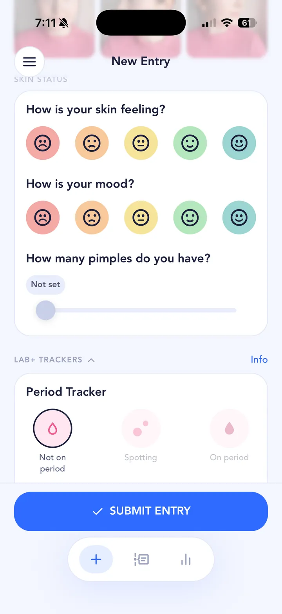

## The short answer

For a lot of people, yes. Hormone changes around your period are on every major dermatology list of acne triggers, and surveys suggest roughly half of women notice their acne get worse in the days before their period. The studies on how common it is are small or based on self-report, though. But not everyone has a cycle pattern, and plenty of "hormonal" breakouts turn out to have other causes. Tracking a few cycles is the quickest way to find out which camp you're in.

## What the research says

Hormones are on every major list of acne causes. The [NHS lists hormone changes "such as during puberty, periods, menopause and pregnancy"](https://www.nhs.uk/conditions/acne/) as a cause of acne, and the American Academy of Dermatology's [adult acne page](https://www.aad.org/public/diseases/acne/really-acne/adult-acne) says women often have fluctuating hormones around their periods, during pregnancy, perimenopause and menopause, and after starting or stopping birth control pills, and that this can lead to breakouts.

How common is the period flare? In a [2001 study of 400 women](https://pubmed.ncbi.nlm.nih.gov/11712049/), 44% said their acne got worse before their period. That flare was more common in women over 33. A smaller [2004 study](https://pubmed.ncbi.nlm.nih.gov/15096370/) actually counted spots across two full cycles in adult women who weren't on acne treatment, and found most of them (63%) had at least a 25% rise in inflammatory spots before their period. A [2014 survey of adult women at a dermatology clinic](https://pmc.ncbi.nlm.nih.gov/articles/PMC4142818/) found 65% said their acne got worse around their period, most often in the week before. [DermNet](https://dermnetnz.org/topics/adult-acne) sums it up simply: "Premenstrual flares are common."

Those are useful numbers, with limits. Two of the studies relied on people's memories, the 2014 one only included women already seeing a dermatologist for acne, and the study that actually counted spots was small. They all point the same way, though: a premenstrual flare is common, real, and far from universal.

## Why it varies from person to person

Everyone's hormones, cycle length and skin are different. Some people have a clockwork flare every month; some see nothing; some only notice it when other things pile up at the same time. The late part of the cycle often comes with other changes too: worse [sleep](/acne-triggers/sleep/), more [stress](/acne-triggers/stress/), cravings for [sugary food](/acne-triggers/sugar/) or [dairy](/acne-triggers/dairy/). Any of those can make it hard to tell whether it's the hormones or the chocolate.

Contraception, pregnancy, perimenopause and conditions that affect hormones can all change the pattern. If your acne is sudden, severe, or comes with irregular periods or extra hair growth, talk to a doctor or dermatologist rather than tracking alone. The [NHS lists](https://www.nhs.uk/conditions/polycystic-ovary-syndrome-pcos/) irregular periods, excess hair growth and acne together as possible signs of polycystic ovary syndrome (PCOS, which the NHS now calls PMOS), something a GP can check for.

## How to test it on your own skin

A cycle pattern is something you can see in your own data, which is exactly what SkinTheory is for: getting scientific about your skin and isolating what's really going on.

1. **Hypothesis.** Start with a clear question, for example "Do I break out on my chin the week before my period?" Set it up as a hypothesis in SkinTheory.
2. **Track.** Each entry, take your three skin photos and log skin feeling, mood and pimple count, plus the **Period** tracker. Keep your skincare routine and products the same for the whole test, so the cycle is the main thing changing.
3. **Analyze.** After about 21 entries (3 weeks if you log daily) you'll have a first look, but for a cycle pattern you really want two or three full cycles. Acne changes slowly anyway: the AAD says [acne treatments usually take 6 to 8 weeks](https://www.aad.org/public/diseases/acne/derm-treat/treat) before you see fewer breakouts. Compare your pimple count against your Period log in the graphs, and use the photo timeline to see whether the same areas flare at the same point each month.

{: .screenshot width="720" height="1565"}

Your photos and cycle data stay private in SkinTheory, never in your camera roll, and you can keep years of history on your phone. Period is a Lab+ tracker, and any two Lab+ trackers can be used for free at a time.

## Tips while you test

- Log your mood too. If your mood dips and your skin flares on the same days, that's worth knowing, and worth mentioning to a doctor.
- Don't start a new product halfway through a cycle. It makes the pattern impossible to read.
- If you do see a clear monthly flare, bring your graphs and photos to a dermatologist. Real data from several cycles is much more useful than "I think it's hormonal".

Hormones rarely act alone. If your flare lines up with cravings, read about [sugar and fast food](/acne-triggers/sugar/) and [dairy](/acne-triggers/dairy/); if it lines up with bad nights, see [sleep](/acne-triggers/sleep/). If you're on a treatment, log your period alongside it so you know whether it's the [treatment](/acne-treatments/) or your cycle that's moving your skin.
