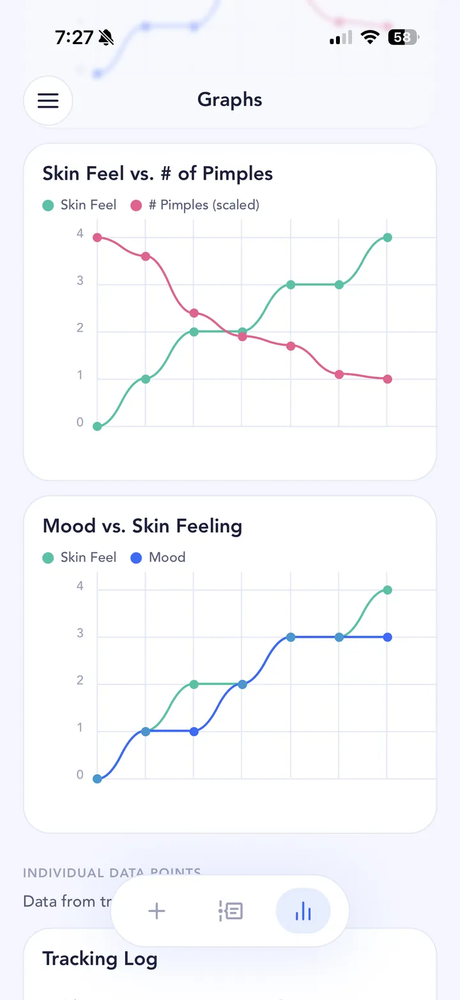

## The short answer

Stress may make acne you already have worse, though it isn't thought to cause acne on its own. That's how the American Academy of Dermatology describes it, and small studies of students during exams point the same way. Most of the evidence is observational, so it shows a link rather than proof that stress is the cause. How much stress affects your skin varies a lot from person to person, so it's worth checking your own pattern.

## What the research says

The AAD says that [stress doesn't cause acne, but may worsen existing acne](https://www.aad.org/public/diseases/acne/causes/acne-causes). Its [adult acne page](https://www.aad.org/public/diseases/acne/really-acne/adult-acne) adds that researchers have found a relationship between stress and acne flare-ups, and explains that stress triggers the body to make more androgens, hormones that stimulate oil glands and hair follicles.

The classic study is from [2003, following 22 university students](https://pubmed.ncbi.nlm.nih.gov/12873885/) through calm periods and exam periods. Their acne was worse during exams, and the more their stress went up, the more their acne worsened. That held even after the researchers accounted for changes in sleep and diet. It was a small study, but it was one of the first to measure the link rather than rely on anecdotes. Changes in diet quality were also linked with worse acne in the same study.

A [2007 study of 94 secondary school students in Singapore](https://pubmed.ncbi.nlm.nih.gov/17340019/) compared exam time with the summer holidays. Higher stress went along with more severe inflamed acne, but the link was weak and mostly seen in boys. Interestingly, oil (sebum) production didn't change between the two periods, so how stress affects acne isn't settled. A [2025 systematic review](https://pubmed.ncbi.nlm.nih.gov/40988809/) of 11 studies in medical students found that 9 reported a significant link between stress and acne severity. Nearly all were one-off surveys, which can't show which came first.

So the link is fairly consistent, but the studies are small or observational, and nobody has shown that reducing stress clears acne.

## Why it varies from person to person

Stress looks different for everyone, and it rarely travels alone. A stressful month might also mean worse [sleep](/acne-triggers/sleep/), more takeaways and [sugar](/acne-triggers/sugar/), more [alcohol](/acne-triggers/alcohol/), skipped skincare routines and more touching or picking at your face. Any of those could be doing the damage.

It can also loop. The [NHS notes](https://www.nhs.uk/conditions/acne/) that acne can cause anxiety, low mood and low self-esteem, so a breakout can add stress, which can make the next breakout worse. Breaking that loop sometimes starts with seeing the pattern clearly.

## How to test it on your own skin

SkinTheory doesn't have a stress tracker, and we'd rather be honest about that. But your mood log is a decent rough proxy, and a hypothesis lets you test a specific stressful period. It's still getting scientific about your skin, with your own data.

1. **Hypothesis.** Pick a real event or pattern, for example "Does exam week make my jaw break out?" or "Do I get more spots after a stressful week at work?" Set it up as a hypothesis in SkinTheory.
2. **Track.** Each entry, take your three skin photos and log skin feeling, mood and pimple count. Mood is your stress stand-in: be honest with it. If you can, add the **Sleep** tracker too, since sleep and stress tend to move together. Keep your skincare routine the same, even when you're busy.
3. **Analyze.** After about 21 entries (3 weeks if you log daily), compare mood against pimple count in the graphs, and check whether breakouts follow low-mood days. Scroll the photo timeline across the stressful stretch. Acne changes slowly (the AAD says [acne treatments usually take 6 to 8 weeks](https://www.aad.org/public/diseases/acne/derm-treat/treat) to show results), so a longer run before and after a stressful event tells you more.

{: .screenshot width="720" height="1565"}

Your mood logs and photos stay private in SkinTheory, never in your camera roll, and they're yours to keep.

## Tips while you test

- Keep your routine simple during stressful weeks so it doesn't get skipped. Routine reminders can help.
- Try not to pick. The [NHS advises](https://www.nhs.uk/conditions/acne/) not to pick or squeeze spots because it can cause scars.
- If stress, anxiety or low mood are hard to manage, talk to a doctor. That matters on its own, not just for your skin.

Stress overlaps heavily with [sleep](/acne-triggers/sleep/) and, for many people, [your period](/acne-triggers/period/). If you're on a treatment, keep logging mood alongside it so you know whether it's the [treatment](/acne-treatments/) or your life that's changing your skin.
